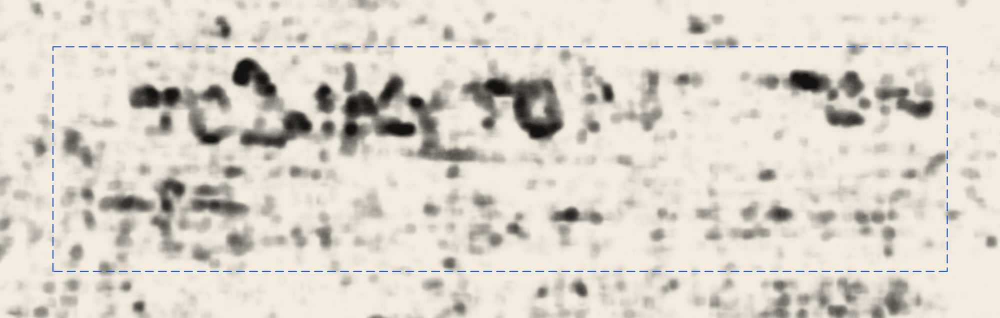
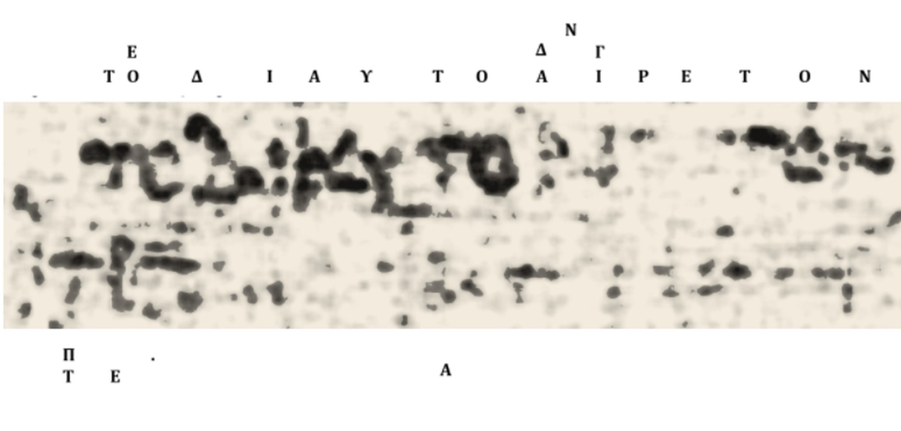
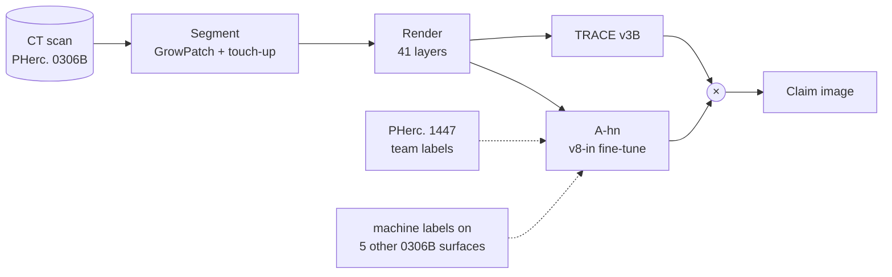
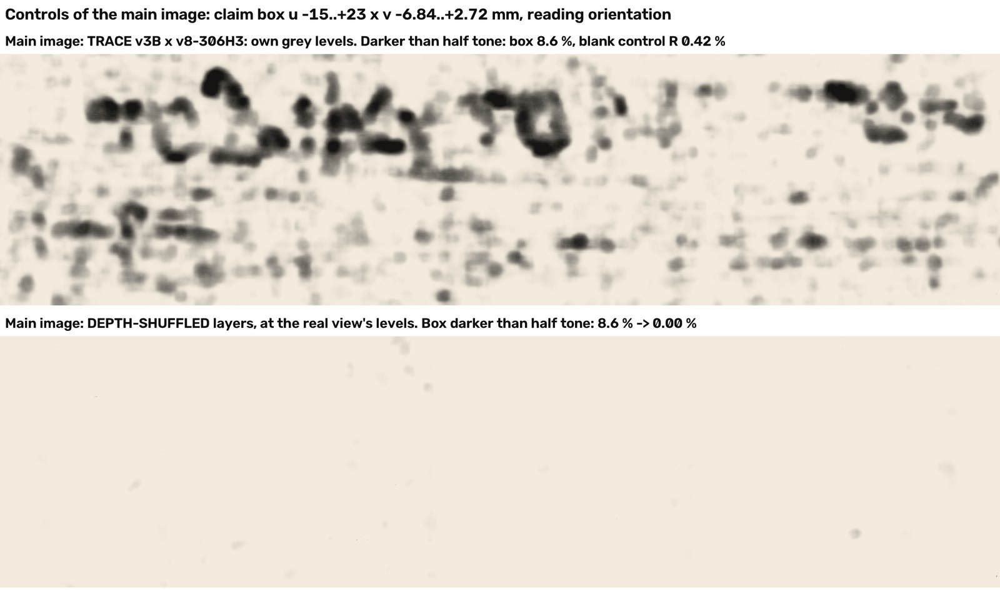

<div align="center">

# PHerc. 0306B: First Letters

Two lines of Greek text read in the Herculaneum scroll PHerc. 0306B, from the Vesuvius Challenge CT scan.

[](https://scrollprize.org/prizes#first-letters-prizes)
[](LICENSE)
[](LICENSE-DATA)
[](https://huggingface.co/Prodigle/pherc0306b-ink-ahn)
[](https://huggingface.co/datasets/Prodigle/pherc0306b-first-letters)
[](docs/REPRODUCE.md)



<sub>The claim box, 3.6 cm² on the scroll. Dark is ink.</sub>

</div>

## Contents

- [At a glance](#at-a-glance)
- [The text](#the-text)
- [How it was made](#how-it-was-made)
- [Checks](#checks)
- [Reproduce it](#reproduce-it)
- [Models and data](#models-and-data)
- [Repository layout](#repository-layout)
- [Licence, credits and citation](#licence-credits-and-citation)

## At a glance

| | |
|---|---|
| Scroll | PHerc. 0306B, volume `20250521133212` (ESRF, 8.64 µm voxels, 116 keV) |
| Text | two lines in a 38.0 × 9.56 mm box, 3.60 cm² on the scroll surface |
| Surface | VC3D GrowPatch on the m7 surface prediction, as a tifxyz mesh |
| Ink | product of TRACE v3B and A-hn (fine-tune of v8-in) |
| Training | PHerc. 1447 team labels and machine labels on five other PHerc. 0306B surfaces |
| Held-out test | PHerc. 0841 known text: AUC 0.874, AP 0.731 |
| Reproduction | a Docker image redraws the claim image byte for byte |
| Team | Liam Warner (segmentation, ink detection) and Nicola Bodill (papyrologist) |

## The text

<p align="center"></p>

Nicola Bodill reads (Leiden conventions):

> τὸ̣ δι’ αὑτὸ α̣ἱ̣ρ̣ε̣τ̣όν
>
> π̣ [

"That which is choiceworthy for its own sake." Aristotle uses the same phrase in the *Metaphysics*: ἀλλὰ μὴν καὶ τὸ καλὸν καὶ τὸ δι᾿ αὑτὸ αἱρετὸν ἐν τῇ αὐτῇ συστοιχίᾳ.

The full claim image, with its 1 cm scale bar, is [`submission/PHerc0306B_20250521133212_w074own_touchup_V5Rc.png`](submission/PHerc0306B_20250521133212_w074own_touchup_V5Rc.png). [`submission/ink_over_CT.jpg`](submission/ink_over_CT.jpg) lays the same ink over the CT.

## How it was made



We found the line by screening. A spiral fit gave every winding in one band of the scroll, and we rendered and inked each of them, then scored the windows with a row score and a small glyph classifier. The classifier ranked a line on winding 74 first of 72 candidates.

The claim surface is a VC3D GrowPatch grown from one seed on that line, using the m7 surface prediction. Near the line's right end it drifted off the sheet, so we moved those nodes to where two independent spiral fits and a sheet tracker agree. We rendered 41 layers from it, 1 voxel apart and centred on the surface.

Two ink models read the render, and the claim image is the product of their probabilities: a pixel is dark only where both see ink. TRACE v3B is a public model. A-hn is the average of three fine-tunes of v8-in, each 600 steps, trained half on the PHerc. 1447 team labels and half on machine labels made by averaging four public models on five other surfaces of this scroll. Its loss adds a penalty for ink predicted on blank papyrus. The grey scale runs linearly from the median to the 99.9th percentile, and ticks in the margin mark the rows.

[`docs/METHOD.md`](docs/METHOD.md) gives each step with its code and records.

## Checks

<p align="center"></p>

<p align="center"><sub>Top: the claim box. Bottom: the same models after the CT's depth layers are shuffled.</sub></p>

| check | result |
|---|---|
| depth shuffle | box pixels darker than half tone fall from 8.6 % to 0.00 % |
| blank strip of the same sheet, chosen in advance | 0.42 % darker than half tone |
| decoy model, trained on labels shifted 3.5 × 3.0 mm | blurred strokes |
| known text, PHerc. 0841 (held out) | AUC 0.874, AP 0.731; 6.1 % false ink at 80 % stroke recall, against 8.5 % for TRACE v3B alone and 12.1 % for v8-in |

## Reproduce it

The Docker image is in the dataset repo. Each command takes a few minutes on four cores:

```bash
zstd -dc fl-claim-a7_final.tar.zst | docker load
docker run --rm -v $PWD/out:/out fl-claim-a7:final            # redraw the claim images and compare bytes
docker run --rm -v $PWD/out:/out fl-claim-a7:final smoke      # re-run A-hn on a CT crop
docker run --rm -v $PWD/out:/out fl-claim-a7:final exclusion  # re-check the training tiles against the exclusion zone
```

To build the image from source instead, run `bash docker/build.sh` ([`docker/README.md`](docker/README.md)). [`docs/REPRODUCE.md`](docs/REPRODUCE.md) covers the download, the GPU modes and running each step from the public CT.

## Models and data

| what | where | size |
|---|---|---|
| A-hn weights (three seeds, every saved stage), the decoy and comparison models, training records | [Hugging Face model repo](https://huggingface.co/Prodigle/pherc0306b-ink-ahn) | 6 GB |
| training data at every stage, the claim's ink maps and render, the Docker image | [Hugging Face dataset repo](https://huggingface.co/datasets/Prodigle/pherc0306b-first-letters) | 17 GB |
| mesh, claim image, method records, checks, the code as it ran | this repository, [`submission/`](submission/) | 0.4 GB |

[`docs/MODELS_AND_DATA.md`](docs/MODELS_AND_DATA.md) lists every file with its checksum.

## Repository layout

```
pherc0306b-first-letters/
├── README.md
├── LICENSE                  MIT, for the code
├── LICENSE-DATA             CC BY-NC 4.0, for weights, data and images
├── docs/
│   ├── METHOD.md            segment, render, models, training, image, validation
│   ├── REPRODUCE.md         Docker and step-by-step reproduction
│   ├── MODELS_AND_DATA.md   what is on Hugging Face, with checksums
│   └── CREDITS.md           models and data we used, and their licences
├── docker/                  builds the Docker image from public sources
├── discovery/               the screening scripts that found the line
└── submission/              the accepted claim package
    ├── PHerc0306B_20250521133212_w074own_touchup_V5Rc.png   the claim image (record in .json)
    ├── mesh/                the tifxyz mesh and its distortion figures
    ├── method/              training records and checks, with an index
    ├── code/                image, control, surface and training code
    ├── docker/              the Docker recipe and third-party notices
    └── supporting/          per-model views, controls and letter grids
```

## Licence, credits and citation

Code is MIT ([`LICENSE`](LICENSE)). Weights, data, maps and images are CC BY-NC 4.0 ([`LICENSE-DATA`](LICENSE-DATA)), like the Vesuvius Challenge data they come from.

This work builds on:
- the Vesuvius Challenge scan, m7 surface prediction, VC3D and villa tools;
- v8-in and the PHerc. 1447 team labels (Youssef Nader and the Vesuvius Challenge);
- TRACE v3B (Jashann);
- Reader V3 and Reader v2 (domenicor046);
- Erwin Nieuwlaar's open PHerc. 343 recipe.

[`docs/CREDITS.md`](docs/CREDITS.md) gives sources and licences.

```bibtex
@misc{warner2026pherc0306b,
  author       = {Warner, Liam and Bodill, Nicola},
  title        = {{PHerc. 0306B}: First Letters},
  year         = {2026},
  howpublished = {\url{https://github.com/SirProdigle/pherc0306b-first-letters}},
  note         = {Vesuvius Challenge First Letters prize}
}
```

Contact: Liam Warner, [@SirProdigle](https://github.com/SirProdigle) on GitHub, Prodigle on Discord.
